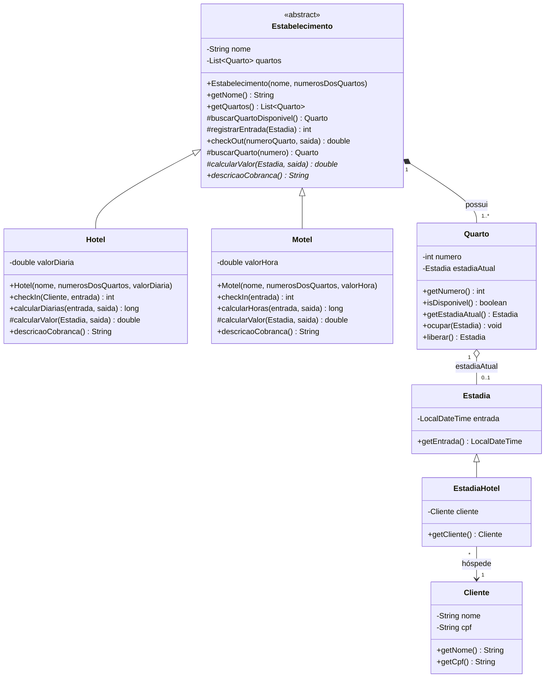

# Modelagem de Classes – Sistema Hotel / Motel

## Diagrama de classes (UML – Mermaid)



## Decisões de projeto

| Requisito | Como foi atendido |
|---|---|
| Classes **Hotel** e **Motel** com **herança** | Ambas herdam da classe abstrata `Estabelecimento`, que concentra o que é comum (lista de quartos, busca de quarto livre, check-out). `Estadia` → `EstadiaHotel` é uma segunda herança. |
| Check-in informa o nº do quarto ou que não há quartos | `checkIn(...)` devolve o número do quarto ocupado, ou `-1` (constante `SEM_QUARTO`) quando todos estão ocupados; o menu mostra a mensagem correspondente. |
| Check-out informa o valor | `checkOut(numero, saida)` libera o quarto e devolve o valor calculado. |
| Hotel exige nome e CPF; Motel não | `Hotel.checkIn(Cliente, ...)` recebe um `Cliente`; `Motel.checkIn(...)` não recebe cliente nenhum. |
| Quarto ocupado não pode receber outro cliente | `Quarto.ocupar()` lança `IllegalStateException` se já houver uma estadia; além disso, o check-in só escolhe quartos com `isDisponivel() == true`. |
| Hotel cobra por diária / Motel por hora | Polimorfismo: o método abstrato `calcularValor()` é implementado de forma diferente em cada subclasse. |
| Um só tipo de quarto (casal) | Existe apenas a classe `Quarto`, sem tipos. |
| Sem reservas | Não há classe/fluxo de reserva; só check-in e check-out. |

## Como compilar e executar (Java 8 ou superior)

```bash
javac -encoding UTF-8 -d out src/*.java
java -cp out Main
```

Ao pedir data/hora, basta apertar Enter para usar o momento atual, ou digitar no formato
`dd/MM/aaaa HH:mm` (útil para simular uma estadia longa e ver o cálculo funcionando).

## Regras de cobrança

* **Hotel:** cada período de 24h iniciado conta como uma diária (mínimo 1 diária).
  Ex.: 25h de permanência = 2 diárias.
* **Motel:** cada hora iniciada é cobrada (mínimo 1 hora).
  Ex.: 2h10min = 3 horas.
