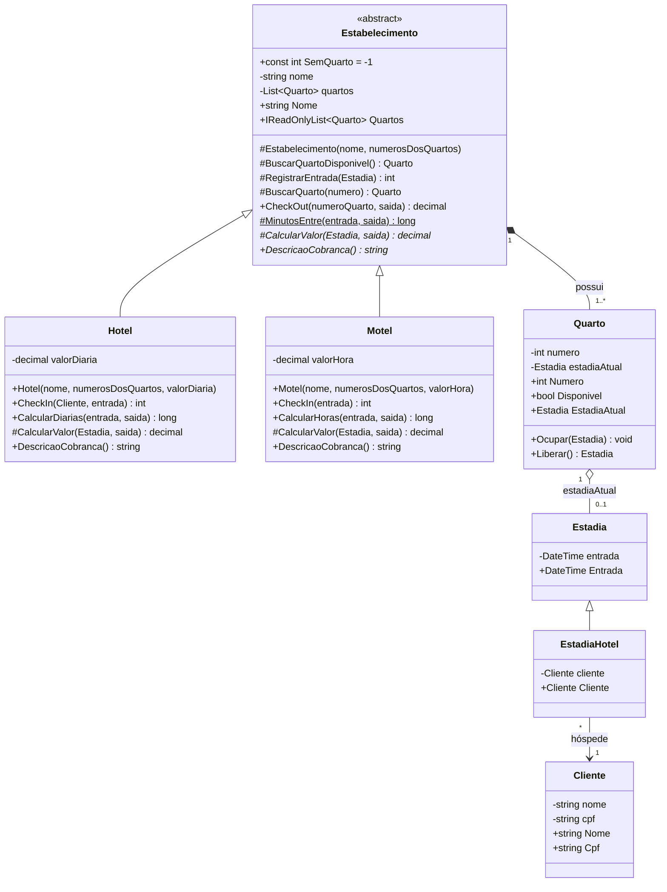

# Sistema Hotel / Motel – Trabalho de POO (C#)

Sistema de check-in e check-out para um Hotel e um Motel, feito em **C#** com **Blazor WebAssembly** (o C# roda direto no navegador).

**Site:** https://otavyo401.github.io/Hotel/

## Diagrama de classes (UML)



## Decisões de projeto

| Requisito | Como foi atendido |
|---|---|
| Classes **Hotel** e **Motel** com **herança** | Ambas herdam da classe abstrata `Estabelecimento`, que concentra o que é comum (lista de quartos, busca de quarto livre, check-out). `Estadia` → `EstadiaHotel` é uma segunda herança. |
| Check-in informa o nº do quarto ou que não há quartos | `CheckIn(...)` devolve o número do quarto ocupado, ou `-1` (constante `SemQuarto`) quando todos estão ocupados; a tela mostra a mensagem correspondente. |
| Check-out informa o valor | `CheckOut(numero, saida)` libera o quarto e devolve o valor calculado. |
| Hotel exige nome e CPF; Motel não | `Hotel.CheckIn(Cliente, ...)` recebe um `Cliente`; `Motel.CheckIn(...)` não recebe cliente nenhum. |
| Quarto ocupado não pode receber outro cliente | `Quarto.Ocupar()` lança `InvalidOperationException` se já houver uma estadia; além disso, o check-in só escolhe quartos com `Disponivel == true`. |
| Hotel cobra por diária / Motel por hora | Polimorfismo: o método abstrato `CalcularValor()` é implementado com `override` de forma diferente em cada subclasse. |
| Um só tipo de quarto (casal) | Existe apenas a classe `Quarto`, sem tipos. |
| Sem reservas | Não há classe/fluxo de reserva; só check-in e check-out. |
| Menu com todas as operações | A página tem um menu: Hotel check-in, Hotel check-out, Motel check-in, Motel check-out e Situação dos quartos. |

## Regras de cobrança

* **Hotel:** cada período de 24h iniciado conta como uma diária (mínimo 1 diária).
  Ex.: 49h de permanência = 3 diárias.
* **Motel:** cada hora iniciada é cobrada (mínimo 1 hora).
  Ex.: 2h10min = 3 horas.

Valores de exemplo: Hotel Central (quartos 101 a 105, R$ 250,00 a diária) e Motel Estrela (quartos 1 a 5, R$ 50,00 a hora), definidos em `csharp/App.razor`.

## Estrutura do código

```
csharp/
├── Dominio/             classes do modelo (Estabelecimento, Hotel, Motel, Quarto, Estadia, EstadiaHotel, Cliente, Formato)
├── App.razor            tela com o menu e as operações
├── Program.cs           inicialização do Blazor
├── HotelMotel.csproj    projeto .NET 8
└── wwwroot/             index.html e CSS
```

## Como executar

* **Online:** abra https://otavyo401.github.io/Hotel/
* **No computador** (precisa do .NET 8 SDK):

```bash
cd csharp
dotnet run
```

* **Hospedar em outro lugar (ex.: Hostinger):** a cada atualização, o GitHub Actions compila o projeto e gera o pacote `site-hostinger` (aba *Actions* → última execução → *Artifacts*). Basta enviar o conteúdo dele para a pasta `public_html`.
